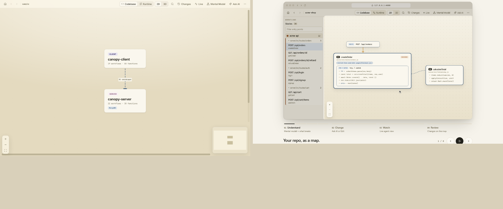
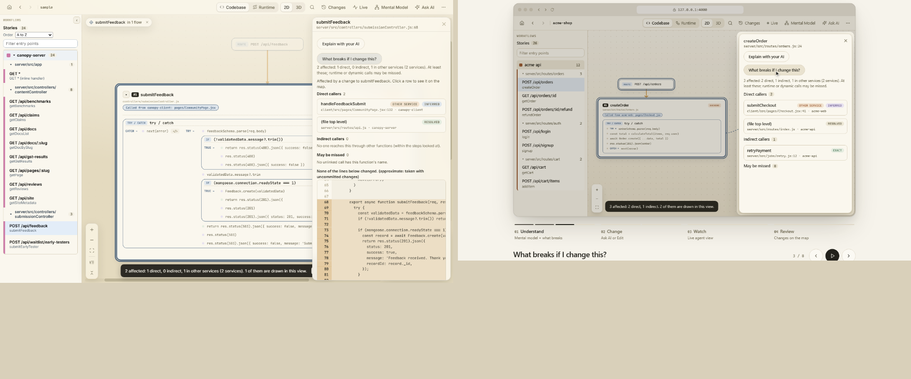
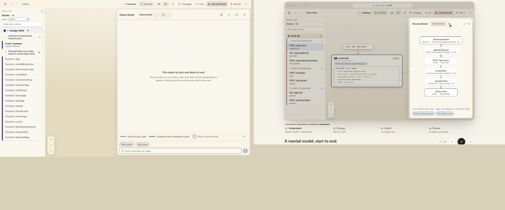
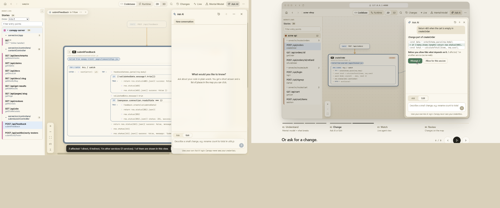
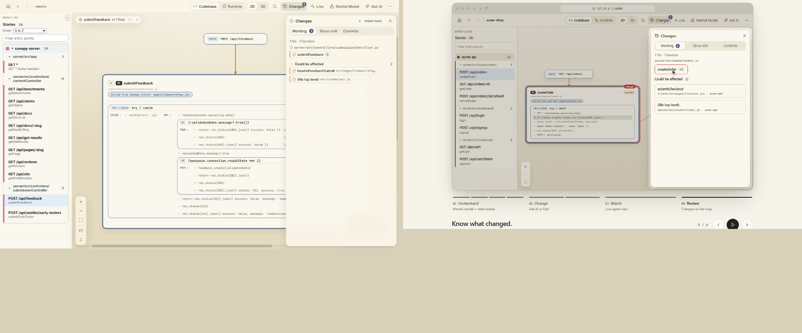

# Zupra home page: report

Branch `zupra-home` in this repo. Committed locally, not pushed or deployed.

## What I built

- **One brand config:** [content/brand.json](content/brand.json). It holds the name, domain, tagline, install and run commands, rename note, privacy line, form links, video and social links, and per-page SEO. The header, footer, hero, install CTA, forms, `index.html` meta, `sitemap.xml`, `robots.txt`, `llms.txt`, the OG image and the server-side page titles all read from it.
- **Home page, in the order you asked for:**
  1. **Hero.** The headline, one supporting line, and the copyable install command (the primary action). Below it is the loop: Understand → Change → Watch → Review, then repeat. Clicking any stage jumps the demo to that chapter.
  2. **Demo.** The centrepiece. Eight steps in four chapters, with an animated cursor, a spotlight, captions, step controls, swipe and arrow keys. You can watch it **in your browser** or **inside VS Code**. It autoplays only while visible; touching any control hands it to you. It's labelled "Illustrative walkthrough on a sample repo".
  3. **Videos.** Fed from [content/videos.json](content/videos.json). While that file is empty, it shows an honest "The first videos are being recorded." with the questions they will answer. Add ids and it becomes a carousel. YouTube loads only after a click, from the privacy-enhanced domain.
  4. **Reviews.** Fed from [content/reviews.json](content/reviews.json). Today it reads "No reviews yet. We only publish real ones." with a link to the feedback form.
  5. **Install CTA.** "Run it on your repo.", both commands, the rename note, the privacy line, and "Coming soon: security review hints."
- **Everything else moved out of the way.** The header has Walkthrough, Docs and Changelog. Benchmarks, GST, claims, reviews and community live in the footer. All old home sections were deleted.
- **Brand:** a new mark (a traced route shaped like a Z, from a start node to an end node), a lowercase `zupra` wordmark, `favicon.svg` (adapts to light and dark), `apple-touch-icon.png` and `og.png`. Regenerate the images with [client/scripts/make-og.mjs](client/scripts/make-og.mjs).
- **Rename:** visible "Canopy" is now Zupra across the site, docs and API messages. `canopy-engine`, `canopy` and `CANOPY_TELEMETRY` stay as they are. The demo mirrors the product, so its one product string ("Canopy never sees your credentials") comes from `brand.productUiName`. That's a one-line switch when the product renames.
- **Forms:** [/community](client/src/pages/CommunityPage.jsx) links to the Google feedback form. Tester and Teams fall back to email until you send their form URLs.
- **Findable:**
  - Every route has its own title, description, canonical and OG/Twitter tags. They're set in the browser and also injected by the server ([server/src/seo.js](server/src/seo.js)), so crawlers and link previews get them without running JavaScript.
  - JSON-LD (`SoftwareApplication`, with no ratings), `sitemap.xml`, `robots.txt` and `llms.txt` are generated at build time.

## Key design and motion decisions

- **The palette comes from the product.** It uses the product's warm paper, ink, slate-blue, sage and clay colours, plus a dark theme derived from them. Every existing page re-skins automatically because the old colour names now point at the new variables.
- **System fonts, like the product.** SF on Mac, Segoe UI Variable on Windows. That means no font download and no layout shift, and the site and app look like one company.
- **One idea per screen.** A big centred headline with only sentences 1 and 2 at full strength, generous spacing and hairline rules. Nothing on the page needs explaining.
- **Motion.**
  - The headline rises in with no fade, so it paints immediately.
  - Sections fade up once as you scroll.
  - The demo uses a slow camera (eased zoom and pan), a spotlight that glides between targets, and a cursor with a click ripple.
  - The hero loop runs a quiet highlight bar.
  - Decorative motion starts on your first interaction (or after 6 seconds), so an idle page load stays cheap.
  - Reduced motion turns all of it off. The demo then shows each step's final state, with no cursor and no autoplay.
- **The product mock stays light in dark mode,** because the product has no dark theme. It reads as a lit window on a dark page.
- **Phones get a real layout, not a thumbnail.** The mock rearranges itself like a responsive app: the sidebar collapses, the toolbar becomes icons, panels become bottom sheets, and the camera frames the function being discussed. The VS Code view drops the explorer, agent panel and activity bar as space runs out, and keeps the app and terminal.
- **The demo loads only when someone scrolls toward it.** It always starts below the first screen, so this costs nobody anything and keeps the first load small. Secondary pages are code-split too: the home JavaScript is 15 KB gzip plus the React chunk.

## How I made the demo match the real product

- I ran the installed `canopy` (0.1.20) on a copy of a sample repo in a temp folder, with the browser and telemetry turned off.
- I walked the real viewer with Playwright: map, workflow, node panel and "What breaks if I change this?", Mental Model, Ask AI (Ask and Edit), Live, and Changes (after editing a file in the copy). I also read the engine's UI source for colours, wording and the Live view's states. No engine code was copied; everything was recreated.
- Wording taken from the real UI includes "What breaks if I change this?", "Direct callers / Indirect callers / May be missed", the confidence chips, "At least these; runtime or dynamic calls may be missed.", "Found in your code / Connected by AI, checked in code", "Before you allow this: what depends on it", "Allow once / Allow for this session", "Uses your own Ask AI login…", "Working / Since visit / Commits", "Could be affected", the Live view's NOW line, task progress, green read glow and amber edit glow, and the red outline on changed nodes.

Side by side, real product on the left and demo on the right:

| | |
|---|---|
| Map |  |
| What breaks if I change this? |  |
| Mental Model |  |
| Ask AI · Edit |  |
| Changes |  |

Also in the folder: [VS Code view, Live](report-assets/demo-vscode-live.png), [VS Code view, Edit](report-assets/demo-vscode-edit.png), [all 8 steps on a phone](report-assets/demo-phone-steps.png), [hero, light](report-assets/home-hero.png) and [hero, dark](report-assets/home-hero-dark.png).

## What still differs from the real product

- **Live** was only visible empty in the real app (no agent session was running). Its working state is rebuilt from the engine's source and CSS, so layout details may differ slightly.
- **Ask AI answers and the Edit card** were not run for real, because that needs a Claude login. The structure and wording follow the source; the exact layout is approximate.
- **Mental Model** in the real app starts empty, and you pick a start and an end. The demo shows the joined chain straight away.
- The second function card and its dashed connector are a simplification of how the real map draws called functions.
- The repo (`acme-shop`) and its numbers are made up and labelled as such. Runtime, 3D and search aren't shown.

## Checks

- **Browser QA:** every demo step in both views at 390, 768, 1440 and 1920px. Light and dark, plus reduced motion and keyboard (tab order, focus rings, arrow keys). The console was clean throughout, with no horizontal scroll.
- **Lighthouse, mobile, home page:**
  - Accessibility, Best Practices and SEO scored 100 on every run.
  - CLS was 0 and LCP 1.7 s.
  - **Performance was 84, 87, 92 and 96 over four runs, median about 90.** This machine was at about 60% CPU from other apps throughout, and total blocking time swung from 170 ms to 550 ms run to run. Please re-check on a quiet machine or with PageSpeed Insights after you deploy.
- **Tests:**
  - Server: `npm test` passes. I updated two assertions: the claims title now reads "Zupra Claims", and reviews are now a `reviews` list.
  - Client: `npm run test:smoke` passes. **It was already failing before my changes,** because of your uncommitted react-router v7 bump. I fixed the import. Run it from `C:\…`, not `c:\…`: Node loads two copies of React when the drive-letter case differs.
- **Server bugs I found and fixed:** the HTML shell was cached forever, which served stale asset names after a rebuild, and missing `.js`/`.css` requests came back as HTML instead of 404.
- **Claims:** [content/claims.md](content/claims.md) now covers the new tagline, the rename, source-available, credentials and code, every view the demo shows, and security hints as planned. I also removed an invented Discord link from the docs sidebar and a "safely" in the error screen.

## What I need from you

1. Google Form URLs for **tester** and **Teams**, to go in `brand.json` → `forms`. They fall back to email until then.
2. **YouTube video ids** (plus title, question and duration), added to `content/videos.json`, and your **channel URL** in `brand.json` → `links.youtubeChannel`.
3. **Analytics:** none is wired yet. Tell me the provider and token or domain. There's a `brand.json` → `analytics` slot, and the CSP will need that one domain added.
4. In production, set `CORS_ORIGIN` to include `https://zupra.dev`. Built assets are requested with `crossorigin`, so a missing origin returns 403. This behaviour predates my changes.
5. Optional: a public GitHub URL, if you want one linked.

## Read-only and cleanup proof

canopy-engine (`C:\Canopy`), `git status --porcelain` plus HEAD:

```
before:  M scripts/git-hooks/post-commit
         M scripts/git-hooks/post-merge
         40d721da4593122ec3e1e19520d7a5f7971d3faf
after:   M scripts/git-hooks/post-commit
         M scripts/git-hooks/post-merge
         40d721da4593122ec3e1e19520d7a5f7971d3faf
```

Identical. Those two modifications were already there and aren't mine. Nothing was built, installed or run inside canopy-engine. The real app ran from the global npm install against a temp copy.

**Processes:** every process I started (the canopy viewer, the QA server, Playwright and Lighthouse browsers) was killed by process tree, and a final check found none left and port 5055 free. Two `canopy` processes that started before this session (PIDs 21528 and 13536, from 2026-11-12 23:15) belong to you and were left running.

**Repo:** your uncommitted react-router v7 bump is included in my commit, because the fixed smoke test depends on it. I removed the inline speculation-rules script from `index.html`; the production CSP was already blocking it.
